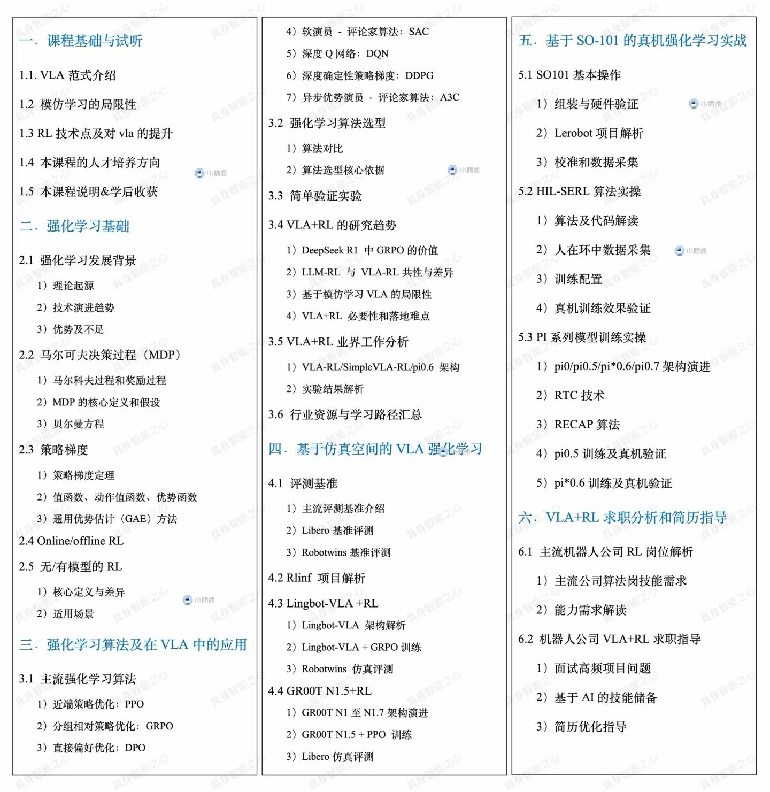
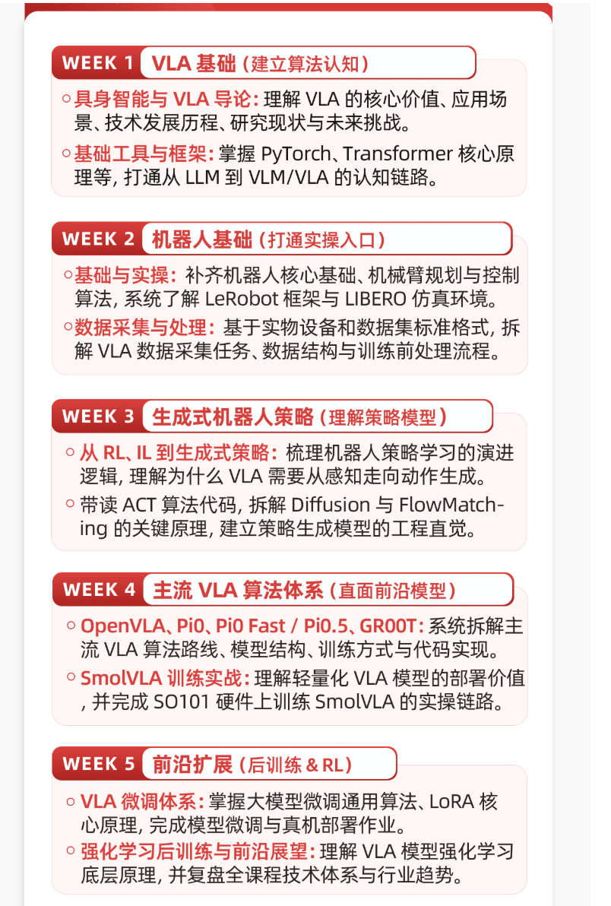
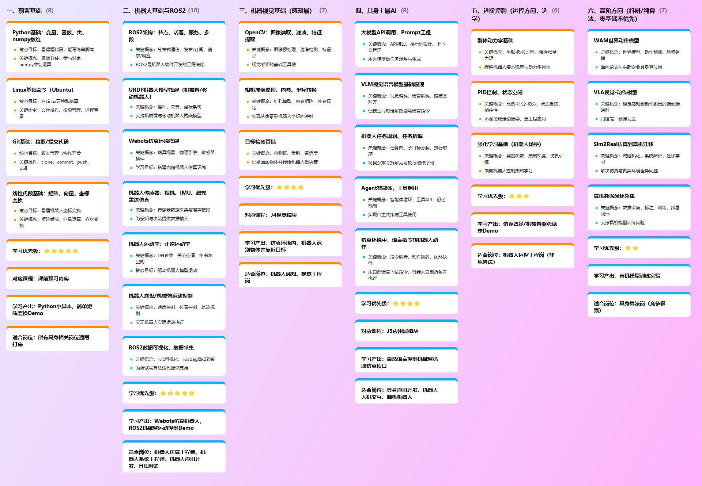
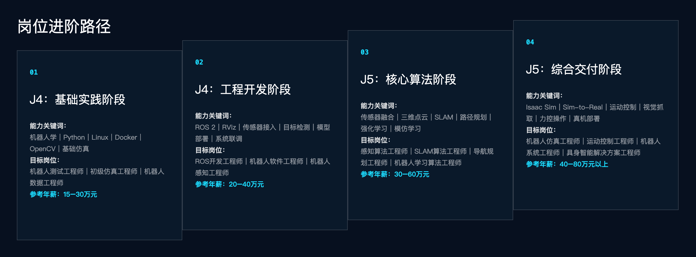

vla 
    course  VLA 基础 世界模型这些
        1. 具身智能之心 -小秋 
            
            真机强化学习：
            
            价格：6499 主从机械臂 
            手机端APP
            试听：https://www.zdjszx.com/p/t_pc/course_pc_detail/video/v_6a0a69b8e4b0694c350a4ec3?product_id=course_3CyVXQBToXseX3sfpyEELHf3nJi&type=6
            
            新课：
            一：SCI/CCF科研1v6小班7月招生方向
            方向1：围绕自动驾驶VLA、WAM、因果推理尖端方向 还差3位
            方向2：围绕具身智能VLA，WAM，VLA+RL协调融合方向 还差1位
            方向3：围绕自动驾驶多模态图像感知方向 还差5位
            方向4：围绕AI Agent 驱动的深度科研辅助、逻辑推理与学术仿真方向  还差5位

            二：具身/自驾项目实战课新课首发（26下）
            1：⾯向求职与转行的VLA,WAM实战⼩班课（视频学习+答疑）第⼆期
            2：面向量产的端到端实战小班课（视频学习+答疑）第二期
            具身智能之心推出1v1科研论文保发班以下课题idea，均可发表CCF A/B
            1：面向空间视觉-语言模型（VLM）的符号化几何证据治理框架
            2：面向精密相机运动控制的视频扩散世界模型姿态注入机制探索
            3:  基于轻量化架构的手机端侧实时单目深度估计
            4：基于人类视频学习的 Sim-to-Real 迁移
            5：面向长期记忆与多步推理的VLA+RL架构
            6：面向样本效率提升的VLA+RL混合训练策略
            7：基于世界模型的虚实迁移与泛化能力提升
            8：WAM驱动的反事实推理与可解释性增强
            9：融合触觉与力反馈的多模态世界模型
            10：World-Action Model 中的高效表征演化

            如果你想寻求的科研的突破，可以与我们平台的大佬1v1meeting交流，双向选择合适再合作，不合适不收费

        2. Xbotics
            https://appqpvv4xwu6898.h5.xiaoeknow.com/v1/goods/goods_detail/course_3DGQSQX4dv63kHei98pe3eUhVLQ
            价格1000
            

        3. 尚硅谷 无 
        4. 咕泡 -唐宇迪？ 比较乱 偏传统 缺少vla
            https://xcnjgbya8cnm.feishu.cn/wiki/TwBww2v8viEIODk8S8VcULgGnsk
            file:///Users/shunyi/Library/Containers/com.tencent.xinWeChat/Data/Library/Application%20Support/com.tencent.xinWeChat/2.0b4.0.9/a31cd55b220ceed17fb27d5f8233c831/Message/MessageTemp/f628f40290ad2b11354d84d4748dcf63/File/%E5%85%B7%E8%BA%AB%E6%99%BA%E8%83%BD%E7%B3%BB%E7%BB%9F%E7%8F%AD-J4+J5-%E8%AF%BE%E7%A8%8B%E4%BB%8B%E7%BB%8D.html

        5. 黑马 
            https://robot.itheima.com/
            https://robot.itheima.com/?airobotzly
            只有广州有线下课， 5个月 10月20第一期

            
        6. 华清远见  嵌入式 太散
        7. 智联计划 张东
    东林钟声
        clip  *****
            https://www.bilibili.com/video/BV17YHY6LEPN/?trackid=web_pegasus_0.router-web-pegasus-2479516-sm4rx.1791536069722.102&spm_id_from=333.1007.tianma.2-3-6.click&vd_source=5fbbf73ac125de3ba3eb7dec5a8e12cb

agent llm 大模型
        1. 八斗
        2. 尚硅谷
        3. 

recommend

    黑马课程介绍
     阶段1.robot 历史 python  机器人编程综合实战
     阶段2.机器人与具身智能数学 编程基础  建模与传感编程实战
        用 Python /C++ 实现 6 轴机械臂正/逆运动学并做 TF 树可视化；
        IMU+相机传感器数据处理与可视化；
        交付可运行代码 + 规范 Git 仓库 + 项目报告 
    阶段3. 机器人硬件与感知系统入门
        机器人硬件组成（关节模组/舵机/减速器/末端执行器/电源管理）；
        核心传感器（编码器/IMU/深度相机/激光雷达/力矩·触觉传感器）原理与实操；
        Jetson 边缘计算平台；
        硬件选型 checklist；
        实机安全规范（急停/力限制）；
        机器人真机操作
        Linux 与ROS2 开发环境搭建
        ROS2 架构（DDS/RMW/节点/话题/服务/动作/参数/lifecycle）与 QoS 实时性认知；
        虚拟机器人建模与仿真实操
        URDF/Xacro 建模语法与最佳实践
        连杆/关节/碰撞/视觉/惯性属性
        Gazebo 与 Isaac Sim 仿真平台（物理引擎/传感器插件/材质）；
        TF 树可视化；
        sim2sim 验证
        Isaac Sim 高保真配置 + domain randomization 基础 + ros2_control 接口 
        基础机器人环境搭建与仿真验证项目
    阶段4 具身智能运动控制（精准驱动与遥操作
        机器人运动控制核心算法
    阶段5 具身智能感知融合视觉、语音与 SLAM

    阶段6  具身智能智能决策（大模型规划与强化学习）

    阶段7 具身智能端到端落地（VLA /RL与多模态感知融合）